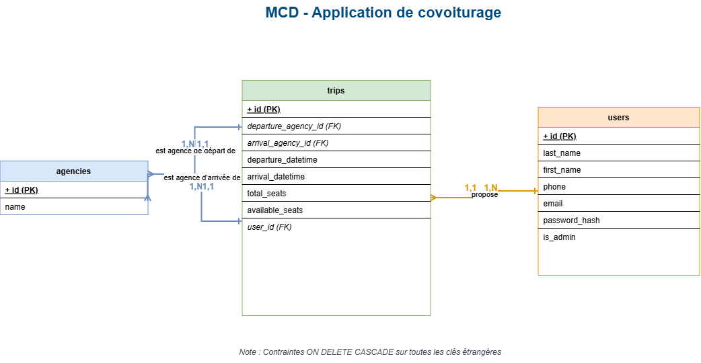

# 🚗 Touche pas au klaxon – Application de covoiturage intranet

---

## 📋 Description

Application web de covoiturage interne développée en **PHP** (architecture **MVC**) pour une entreprise multi-sites. L'accès est strictement réservé aux collaborateurs authentifiés.

### ✨ Fonctionnalités

- **Portail Intranet** : accès sécurisé par formulaire de connexion.
- **Gestion des trajets** :
  - Consultation des trajets disponibles (via des cartes responsives).
  - Affichage des détails en modale (AJAX).
  - Création, modification et suppression d'un trajet (réservé à l'auteur).
- **Administration** :
  - Gestion des utilisateurs (Création, Consultation, Soft Delete).
  - Modification des rôles (Promouvoir / Rétrograder un utilisateur).
  - Gestion des agences (CRUD complet).
  - Supervision et suppression de tous les trajets.
- **Design** : interface 100% responsive (Bootstrap 5), navigation mobile (menu burger), icônes et alertes dynamiques.

---

## 🛠️ Installation

### 📌 Prérequis

- XAMPP (Apache + MySQL)
- PHP 8.0 ou supérieur
- Composer
- Node.js (npm) *(optionnel)*

### 🔧 Étapes

#### 1️⃣ Cloner le projet

Dans le dossier `htdocs` de XAMPP :

```bash
git clone https://github.com/MacFly-99/Touche_Pas_Au_Klaxon.git covoiturage
```

#### 2️⃣ Démarrer XAMPP

Lancer **Apache** et **MySQL** depuis le panneau de contrôle XAMPP.

#### 3️⃣ Configuration de l'environnement

Dupliquer le fichier `.env.example` (ou créer un fichier `.env` à la racine) et configurer vos accès MySQL ainsi que le mot de passe du Super Admin :

```env
DB_HOST=localhost
DB_NAME=covoiturage
DB_USER=root
DB_PASS=

ADMIN_EMAIL=admin@covoiturage.fr
ADMIN_PASSWORD=VotreMotDePasseSecurise
```

#### 4️⃣ Base de données et données de test

1. Ouvrir phpMyAdmin : <http://localhost/phpmyadmin>
2. Importer `sql/create_database.sql` *(crée la base de dev ET la base de test)*.
3. Dans le terminal, lancer le script de peuplement :

```bash
php seed.php
```

> Ce script génère des mots de passe aléatoires pour les utilisateurs de test et crée un fichier `identifiants_test.txt` avec tous les accès.

#### 5️⃣ Installer les dépendances

```bash
composer install
```

#### 6️⃣ Accéder à l'application

Ouvrir un navigateur : <http://localhost/covoiturage/public/>

### 🔐 Identifiants de test

Les identifiants sont générés automatiquement à l'étape 4 dans le fichier `identifiants_test.txt`.

| Rôle            | Identifiants                                         |
| --------------- | ---------------------------------------------------- |
| 👑 Admin         | Définis dans le fichier `.env`                       |
| 👤 Utilisateurs  | Mots de passe aléatoires générés par `seed.php`      |

---

## 🛡️ Sécurité (points forts du projet)

Ce projet intègre les normes de sécurité actuelles pour les applications web :

- **Mots de passe** : hachage robuste via `password_hash()` (Bcrypt).
- **Injections SQL** : 100% des requêtes utilisent des requêtes préparées (PDO).
- **Failles XSS** : échappement systématique des données (`htmlspecialchars`) dans les vues et l'API JSON.
- **Failles CSRF** : génération et vérification de jetons (tokens) uniques sur tous les formulaires POST.
- **Sessions** : cookies HttpOnly, régénération de l'ID après connexion.
- **Soft Delete** : la suppression d'un utilisateur (`deleted_at`) conserve ses trajets en base de données (intégrité référentielle).
- **Headers HTTP** : protection contre le Clickjacking et le MIME Sniffing (`Content-Security-Policy`, `X-Frame-Options`).

---

## 📁 Structure du projet

L'application repose sur une architecture **MVC (Modèle-Vue-Contrôleur)** stricte et sécurisée. L'ensemble du trafic web est redirigé vers un point d'entrée unique (le *Front Controller*), garantissant ainsi que les fichiers de configuration et la logique métier ne soient jamais accessibles directement par le navigateur.

```text
covoiturage/
├── app/                     # Cœur de l'application (Logique métier)
│   ├── Config/              # Configuration (ex: Database.php pour la connexion PDO)
│   ├── Controllers/         # Contrôleurs (Traitent les requêtes et renvoient les vues)
│   ├── Core/                # Le moteur MVC (Router, Controller de base, Model de base)
│   ├── Models/              # Modèles (Interactions avec la BDD, requêtes SQL)
│   └── Views/               # Vues (Affichage HTML structuré en sous-dossiers)
│       ├── admin/           # Vues spécifiques au back-office (CRUD Users, Agences...)
│       ├── auth/            # Vues liées à l'authentification (Login)
│       ├── home/            # Vues de l'accueil
│       ├── layout/          # Éléments récurrents (Header, Footer)
│       └── trip/            # Vues de gestion des trajets (Index, Create, Edit)
│
├── public/                  # ⚠️ SEUL dossier accessible par le navigateur (Document Root)
│   ├── assets/              # Ressources front-end (CSS, JS, Images, Logo)
│   ├── .htaccess            # Règle de réécriture d'URL (Redirige tout vers index.php)
│   └── index.php            # Point d'entrée unique (Initialise les sessions, CSRF, Headers, Routeur)
│
├── sql/                     # Scripts de base de données
│   ├── create_database.sql  # Script de création des tables (Dev et Test)
│   ├── MCD.png              # Modèle Conceptuel de Données (Schéma)
│   └── MLD.png              # Modèle Logique de Données (Schéma)
│
├── tests/                   # Tests unitaires automatisés
│   └── Models/              # Tests PHPUnit isolés (AgencyTest, TripTest, UserTest)
│
├── vendor/                  # Dépendances externes PHP installées via Composer
│
├── .env                     # Variables d'environnement (Accès BDD, Mots de passe Admin) - Non versionné
├── .env.example             # Modèle de fichier .env à dupliquer
├── .gitignore               # Fichiers à ne pas envoyer sur GitHub (.env, vendor, node_modules...)
├── .htaccess                # Bloque l'accès aux dossiers sensibles (app/, sql/, etc.) à la racine
├── composer.json            # Dépendances et autoloading PHP
├── phpunit.xml              # Configuration de l'environnement de test
├── seed.php                 # Script CLI générant la BDD de dev et des utilisateurs de test
└── README.md                # Documentation du projet
```

---

## 🧪 Tests

Les tests unitaires sont réalisés avec **PHPUnit**. Ils sont isolés et autonomes (création de données temporaires via des *Fixtures* avant chaque test).

### ▶️ Exécuter les tests

```bash
vendor/bin/phpunit
```

### ✅ Résultat attendu

| Tests | Assertions | Statut |
| :---: | :--------: | :----: |
| 14    | 37         | ✅ OK  |

---

## 💻 Technologies utilisées

| Technologie            | Rôle                                            |
| ---------------------- | ----------------------------------------------- |
| **PHP 8**              | Back-end (architecture MVC)                     |
| **MySQL / MariaDB**    | Base de données                                 |
| **Bootstrap 5**        | Interface utilisateur responsive (CDN)          |
| **Bootstrap Icons**    | Iconographie de l'application                   |
| **PHPUnit**            | Tests unitaires                                 |
| **Composer**           | Gestionnaire de paquets PHP                     |
| **vlucas/phpdotenv**   | Gestion sécurisée des variables d'environnement |

---

## 📊 Modèle de données

### 🧩 MCD (Modèle Conceptuel de Données)



| Association                     | Cardinalités | Lecture                                                                              |
| ------------------------------- | :----------: | ------------------------------------------------------------------------------------ |
| **USER** – publie – **TRIP**    | 0,n / 1,1    | Un utilisateur publie 0 à n trajets ; un trajet a un seul auteur                     |
| **AGENCY** – départ – **TRIP**  | 0,n / 1,1    | Une agence est le départ de 0 à n trajets ; un trajet a une seule agence de départ   |
| **AGENCY** – arrivée – **TRIP** | 0,n / 1,1    | Une agence est l'arrivée de 0 à n trajets ; un trajet a une seule agence d'arrivée   |

### 🗄️ MLD (Modèle Logique de Données)


Version texte :

```text
agencies (id, name)
users (id, last_name, first_name, phone, email, password_hash, is_admin, deleted_at)
trips (id, departure_agency_id, arrival_agency_id, departure_datetime, arrival_datetime, total_seats, available_seats, user_id)
```

### 🔗 Clés étrangères

Toutes les clés étrangères sont définies avec `ON DELETE CASCADE` :

- `trips.departure_agency_id` → `agencies.id`
- `trips.arrival_agency_id` → `agencies.id`
- `trips.user_id` → `users.id`

> ℹ️ Un utilisateur supprimé via le **Soft Delete** (`deleted_at`) conserve ses trajets. Un `DELETE` définitif en base supprimerait ses trajets (cascade).

---

## 🧑‍💻 Auteur

Développé par **Mattéo Ventura** – Projet CEF (MVC PHP).

---

## 📝 Licence

Projet propriétaire – usage interne uniquement.